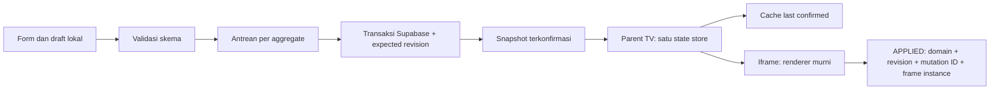

# Audit arsitektur DIGITALv304 — 16 Oktober 2026

Basis audit: kode lokal `1cefc27`, turunan GitHub `a00e1d4`. Commit perbaikan TV/RLS
tersebut belum dipublikasikan. Tidak ada deployment, mutasi Supabase, migrasi data,
atau perubahan frontend produksi dalam pekerjaan audit ini.

Backup sebelum pekerjaan: `/workspace/backups/digitalaljihad-before-architecture-audit-1cefc27.tar.gz`.
SHA-256 `21ada0393642e3f273d4fccfb54cd789b2d47a5aae238a7f530954cab182c3a2`.
695 berkas snapshot dicocokkan hash-nya. Backup lengkap sebelum perbaikan sebelumnya
(termasuk .git) tetap ada di `/workspace/backups/`. Snapshot ini bukan backup database.

## Kesimpulan

Akar masalah bukan kebutuhan pindah ke framework. Kontrak data dan keberhasilan
belum tunggal: sebagian write gagal tetapi diklaim berhasil, cache menganggap nama
event sebagai nama sumber data, renderer masih menentukan prioritas sumber sendiri,
dan pemeriksaan lama banyak membuktikan keberadaan teks/fungsi alih-alih perilaku.
Setiap perbaikan menambahkan jalur khusus sehingga aturan yang harus dipenuhi oleh
fitur berikutnya terus bertambah. Penambahan broadcast atau penghapusan cache secara
massal tidak menyelesaikan ketidakjelasan ini.

Tidak ada jaminan bebas bug 100%. Sasaran yang dapat diverifikasi adalah tidak ada
sukses palsu, penolakan data tidak valid, pemulihan deterministik setelah koneksi
putus, deteksi konflik edit, dan tes yang menolak pelanggaran kontrak sebelum rilis.

## Temuan berdasarkan kode dan reproduksi terisolasi

| Prioritas | Bukti | Dampak / tindakan |
|---|---|---|
| P0 | `js/supabase-db.js`: saveAgendaRutin/saveKajianData/savePengumumanJumat mengabaikan boolean dari saveSettingItem. Probe memaksa false; ketiganya tetap return true dan masing-masing broadcast sekali. | Wajib propagasi error ke pemanggil, jangan commit state/broadcast confirmed sebelum semua operasi berhasil. Gunakan satu transaksi untuk satu aggregate. |
| P0 | `js/admin/admin-agenda-rutin.js`: hasil await tidak diperiksa; badge Tersinkron ditulis setelah catch. `admin-jadwal-sholat.js` mengabaikan hasil save style dan badge sukses ada di finally. | Pisahkan draft, saving, cloud-confirmed, render-confirmed, failed. finally hanya membersihkan status sibuk; bukan mengklaim berhasil. |
| P0 | Password/otorisasi frontend dan RLS anonim yang ditemukan sebelumnya. SQL pengganti lokal memiliki guard; cloud belum dimigrasikan. | Migrasikan sesi Supabase Auth dan RLS bersama-sama di staging. Pastikan public settings tidak membawa password. Jangan mengaktifkan SQL baru pada frontend anon. |
| P1 | `invalidateCache('agenda_rutin')` tidak menghapus cache settings; probe membuktikan cache tetap ada. Data sebenarnya tersimpan pada app_settings key kegiatan_rutin_settings. Parent tidak memiliki refresh master khusus agenda_rutin. Dua slide mendahulukan parent.settings. | Definisikan dependency map domain -> tabel/key -> snapshot. Lebih baik semua iframe membaca snapshot parent yang sudah committed. |
| P1 | Probe admin: semua hari/pekan dihapus, payload berubah menjadi senin/rabu/sabtu dan 1/3. Formatter juga mengganti [] dengan default. | [] harus bermakna pilihan kosong; fallback hanya untuk missing/invalid menurut skema. Jika kosong dilarang, tampilkan validasi dan jangan mengganti diam-diam. |
| P1 | Dua slide agenda/pengumuman tidak membaca flag enabled; renderer memakai if(value) sebelum mengubah deskripsi/pembimbing/lokasi. | Tambahkan kontrak visibilitas; tes true -> false dan teks lama -> kosong. Nilai kosong sah harus membersihkan tampilan, bukan membiarkan teks lama. |
| P1 | getCountdownStyle membaca query URL sebelum settings, meskipun komentar menyebut cloud prioritas 1. Probe cloud=biasa + URL style=flip menghasilkan flip. switchCountdownStyle juga memutasi parent.settings. | Override hanya di route preview/debug eksplisit. Slide tidak boleh menulis state parent. |
| P1 | `admin.html` mengimpor js/admin-pengumuman-jumat.js; berkas yang ada di js/admin/admin-pengumuman-jumat.js. | Perbaiki rute setelah baseline audit disetujui; smoke-test seluruh script lokal pada setiap halaman. Ini temuan pasti, bukan dugaan autosave. |
| P1 | Background sync 30 detik memakai getter cache TTL 10 menit, melewatkan mode sholat, hash jadwal hanya jumlah baris. | Saat reconnect/visibility/resume, tarik revision/snapshot fresh untuk semua domain; pisahkan polling metadata dari cache tampilan. Jangan menjanjikan pulih dalam 30 detik dari implementasi ini. |
| P1 | subscribeRealtime menghapus channel sebelumnya setiap pemanggilan; parent mendaftar melalui onDataChange dan juga subscribeRemoteCommands. Deduplikasi fallback memakai 50 karakter awal data/250ms. | Satu subscription owner, registry subscriber dengan unsubscribe, event ID persisten dari server. Audit duplikasi callback serta kehilangan event saat mount/unmount. |
| P1 | saveSettingItem memakai GET lalu PATCH/POST; durasi dan style disimpan terpisah; settings memiliki alias kolom/value/JSON. | Audit unique key aktual, gunakan RPC/transaksi + optimistic concurrency. Jangan broadcast aggregate setengah tersimpan. Risiko race perlu diuji pada DB staging, bukan diasumsikan constraint-nya. |
| P1 | Suite lama menjadwalkan dua assertion asinkron, lalu process.exit sebelum timer berjalan. | Sudah diperbaiki pada tooling: menunggu pendingTests; 271 assertion kini benar-benar dieksekusi. Mutasi sengaja dibuat gagal dan exit status 1 terverifikasi. |
| P2 | Service worker mencampur network-first HTML/JS dengan CSS/media SWR; media immutable setahun tanpa nama hash; network-first tidak fallback pada HTTP 5xx. cache.put/clear tidak seluruhnya berada di waitUntil. | Versikan aset berdasarkan content hash, pertahankan last-good release, rilis HTML/CSS/JS konsisten; uji timeout, 5xx, quota, storage eviction dan update saat offline. |
| P2 | Variasi layout, formatter, defaults dan loadAgendaData diduplikasi pada agenda-rutin dan pengumuman; banyak nilai user masuk innerHTML. | Satu view-model/formatter per domain, textContent untuk teks user, sanitizer allowlist untuk rich text. Uji payload HTML dan keterbacaan di TV asli. |

Istilah tabel pada deskripsi awal perlu diselaraskan: kode mengakses sholat_jumat;
agenda_rutin sering merupakan nama event logis, sedangkan datanya adalah key dalam
app_settings. Keberadaan tabel petugas_jumat/agenda_rutin di database live belum
diverifikasi. Ketidakcocokan nama ini sendiri dapat merusak invalidasi cache.

## Arsitektur tujuan tanpa framework

Pisahkan dua alur: **rilis kode** (GitHub -> Cloudflare -> service worker) dan
**perubahan konten** (pengurus -> Supabase -> parent TV -> iframe). Perubahan jadwal
pengguna tidak membutuhkan commit GitHub/deploy aset. Versi rilis dan revisi data
adalah dua hal berbeda dan harus dicatat terpisah.



1. **Server authoritative untuk state yang committed.** Kelompokkan data menjadi
   aggregate settings, agenda, prayer schedule, Friday officers, finance dan media.
   Database memberikan revision meningkat per aggregate dalam transaksi yang sama
   dengan write; gunakan row lock/CAS. Timestamp browser bukan revision.
2. **Satu adaptor input.** Semua form mendeklarasikan path, tipe dan saveMode.
   auto-save text dapat debounce 300–600ms; toggle dapat langsung antre. Form manual
   harus punya tombol Simpan, indikator dirty dan peringatan saat meninggalkan draft.
   Jangan memaksa semua form autosave, terutama transaksi keuangan.
3. **Antrean dan konflik.** Serialize operasi per aggregate, simpan baseRevision
   bersama draft, kirim mutationId idempotent. Dua device yang mengedit revision sama:
   satu diterima, satunya konflik terlihat; jangan menerapkan last-write-wins diam-diam.
   Jangan menghapus antrean sebelum server mengonfirmasi commit. Retry memiliki batas,
   exponential backoff/jitter; hasil ambigu diverifikasi melalui mutationId sebelum retry.
4. **Satu store di parent.** UI menyimpan confirmed dan draft terpisah. applyConfirmed
   memvalidasi, menolak revision lama, mengisolasi error subscriber, menyimpan last-good
   snapshot, lalu mendistribusikan snapshot immutable. localStorage hanyalah cache
   confirmed untuk boot offline; draft disimpan terpisah per akun/device.
5. **Realtime sebagai pemberitahuan.** WAL/broadcast membawa domain, revision,
   mutationId. Terima duplikat dengan aman. Jika ada gap, reconnect, atau epoch berubah,
   ambil snapshot baru; jangan berusaha menyambung state dari potongan event yang hilang.
   BroadcastChannel lintas tab adalah hint, bukan bukti data terotorisasi/disimpan.
6. **Protokol iframe.** Pada load, child mengirim HELLO; parent memverifikasi origin
   persis dan source dari registry iframe lalu memberi snapshot + frameInstanceId.
   Child tidak membaca parent.settings, tidak membuka subscription Supabase sendiri,
   dan tidak menulis parent. Semua pesan divalidasi: type, release, schemaVersion,
   domain, revision, mutationId dan frame instance. Source/origin saja bukan autentikasi
   server; channel realtime dan RLS tetap harus diamankan.
7. **Render deterministik.** normalize -> view-model -> render(snapshot). Seluruh
   field terdaftar dibaca dari snapshot yang sama; nilai baru menimpa teks/visibilitas
   lama termasuk empty/false. Tidak ada fetch di renderer. Tunggu pekerjaan async,
   aset yang wajib tersedia, dan kesempatan paint sebelum APPLIED. Frame standby
   hanya boleh melaporkan PREPARED, bukan APPLIED pada layar aktif.
8. **Konfirmasi tepat.** Status terpisah: DRAFT, SAVING, CLOUD_CONFIRMED, RECEIVED,
   PREPARED, APPLIED, STALE/UNCONFIRMED, FAILED/CONFLICT. APPLIED harus cocok dengan
   versi data dan instance frame aktif. Timeout tidak pernah menjadi sukses. Browser
   ACK membuktikan penerapan di browser, bukan bahwa panel fisik TV menyala.
9. **Pertahankan last-good.** Payload tidak valid dikarantina dan dicatat (tanpa data
   sensitif), tampilan terakhir yang valid dipertahankan. Empty sah dibedakan dari
   load failure; untuk critical prayer schedule kosong, tampilkan kondisi unavailable
   sesuai kebijakan masjid, jangan membuat jam fiktif atau nol seolah data benar.

Envelope contoh (referensi, belum menjadi schema DB produksi):

```json
{"schemaVersion":1,"domain":"agenda","revision":42,"mutationId":"uuid-from-committed-command","payload":{"days":["selasa"],"enabled":false}}
```

`reference/signage-store.js` adalah prototipe teruji untuk normalisasi, immutable
snapshot, subscribe/unsubscribe, cache hydration, revision ordering (cache tidak dapat menghalangi snapshot cloud pertama), conflict pada
revision yang sama dan storage failure. Ini **belum dipasang ke halaman produksi**,
belum memiliki transport/antrean/RPC/Auth, dan bukan pengganti migrasi database.
Validator setiap domain harus menolak unknown keys, tipe salah, enum salah, ukuran
payload berlebih dan struktur bersarang yang tidak sesuai. Menambah revision pada
kode klien tanpa revisi transaksi server tidak memberikan proteksi concurrency.

## Linter binding dan batas pembuktiannya

Jalankan setelah `npm install`:

```sh
npm run audit:bindings
npm run audit:bindings -- --json
node scripts/audit-behavior-probes.js
npm test
```

- `binding-contract.json`: manifest 5 kelompok form kritis dan 4 binding display,
  mencakup 14 kontrol fisik. Analisis AST memeriksa alur event -> handler -> write sink;
  manual mode juga harus punya save control dan alur handler/sink.
- `scripts/audit-bindings.js`: parse HTML/JS menggunakan parse5/acorn. Memeriksa script
  lokal hilang, ID ganda, target hilang, path schema tak dikenal, DOM assignment yang
  hilang, kontrak consumer yang hilang, dan kandidat teks jadwal statis.
- Inventaris saat audit: 23 halaman, 220 kontrol; 102 memiliki bukti event statis,
  118 belum dapat diresolusikan event-nya. Ini TIDAK berarti 118 kontrol rusak:
  beberapa memang manual, delegated, atau hanya filter/pratinjau.
- 206 kontrol belum diklasifikasikan saveMode; 4 teks statis perlu tinjauan manusia;
  1 script path terbukti hilang; 3 field kritis belum punya kontrak consumer display.
  Total 214 temuan legacy dicatat dalam `binding-debt-baseline.json`, bukan dihapus.
- `npm test` gagal untuk pelanggaran kontrak eksplisit dan temuan baru di luar baseline.
  Debt lama tetap dicetak meskipun tes hijau. Jangan menjalankan --write-baseline
  otomatis di CI untuk menyembunyikan regresi; baseline harus direview dan dikurangi.
- Analisis statis hanya membuktikan keterhubungan yang dapat ditelusuri, bukan sukses
  request atau kebenaran pemetaan nilai. Alur bercabang, alias dinamis, eval, elemen
  yang dibuat dari template runtime, submit terdelegasi kompleks dan property computed
  bisa memerlukan kontrak serta tes browser tambahan. Teks statis yang memang label
  tidak wajib diberi ID. Target dinamis boleh berupa parent yang membangun subtree.
- `test-binding-audit.js` menguji deteksi dengan mutasi: event dihapus, sink diganti
  string/comment, target diganti, assignment dihapus, script hilang, manual save rusak,
  input baru dan schema typo. `test-agenda-bindings.js` menjalankan renderer asli dua
  slide dengan hari/pekan nondefault, memastikan jadwal, waktu dan teks berubah.
  Tes ini belum mencakup keyboard/mobile, visibilitas, image load atau jaringan live.

## Standar defensif dan definition of done

1. Satu field baru harus memiliki schemaPath, validator, default/fallback policy,
   saveMode dan consumer/binding target. IDs unik per dokumen, bukan unik lintas iframe.
2. Gunakan nullish fallback hanya jika null berarti missing menurut skema. Jangan
   memakai `value || default` untuk boolean/angka/array; validasi false, 0, [] dan ''
   sesuai semantik field. Required text yang kosong ditolak saat input; optional text
   kosong menghapus tampilan lama. Jangan mengubah maksud pengguna tanpa pesan.
3. Payload array/object selalu tipe JSON yang sama. Parsing string JSON legacy hanya
   pada adaptor migrasi sekali; renderer tidak melakukan JSON.parse atau menebak tipe.
   Jam HH:mm, timezone Asia/Jakarta dan batas numeric diperiksa pada boundary.
4. Fungsi mutasi mengembalikan satu bentuk hasil terstruktur, misalnya
   `{ok, cloudConfirmed, revision, mutationId, error}`. Caller wajib memeriksanya.
   Dilarang return true setelah inner save false, catch kosong, atau badge sukses di finally.
5. Write ke confirmed state/broadcast hanya setelah transaksi berhasil; tidak ada
   side effect cloud dari getter, display-only client, fallback offline atau renderer.
6. Binding memakai textContent, DOM API dan formatters bersama. HTML user harus
   disanitasi dengan allowlist yang ditinjau; jangan menyisipkan raw string ke innerHTML.
7. Tambahkan tes perilaku dengan nilai nondefault, lalu update nilai kedua kali;
   uji true->false, angka0, empty array, empty optional text, unicode/HTML, malformed
   JSON, timeout, HTTP403/500, zero rows, stale/out-of-order, duplikat dan konflik edit.
8. Setiap domain harus melewati smoke test parent + iframe + save API di staging;
   unit/regex checks bukan bukti sinkronisasi end-to-end. Sediakan release ID,
   schema version, confirmed revision, received/rendered revision dan last heartbeat
   per perangkat agar sumber masalah terlihat tanpa clear-cache berulang.
9. Uji kompatibilitas di browser TV aktual; pilih sintaks/polyfill menurut perangkat.
   Uji 24–72 jam untuk memory, timer, audio autoplay, sleep/wake dan pergantian slide.
   Tetapkan target p95/p99 latency saat koneksi sehat berdasarkan hasil ukur; jangan
   menjanjikan <100ms untuk seluruh jalur write, jaringan dan paint tanpa pengukuran.

## Prioritas pelaksanaan bertahap

- [ ] P0: backup database dan policy/ACL terverifikasi; migrasi Auth/RLS di staging.
- [ ] P0: hilangkan sukses palsu di semua helper save dan status admin; transaksi agenda,
  kajian, Jumat dan durasi/style. Tes 403, false, partial failure dan zero rows.
- [ ] P1: benahi nama path script admin; smoke test semua sumber script lokal.
- [ ] P1: satu schema/normalizer agenda; tes empty days/weeks, enabled, clear text,
  kedua slide serta parent refresh. Selaraskan invalidation map sambil menunggu store.
- [ ] P1: migrasikan satu domain agenda ke store parent dengan feature flag default OFF.
  Pertahankan fallback legacy yang dapat dipilih; jangan menulis melalui dua jalur.
- [ ] P1: sesudah agenda lulus, pindahkan countdown/jadwal/Jumat satu per satu. Batasi
  URL override ke preview, tetapkan timezone, dan uji transisi mode sholat tanpa reload.
- [ ] P1: revision server + command idempotency + konflik dua perangkat + resync gap.
- [ ] P2: aset hash, release manifest/rollback, offline warm/cold boot dan service-worker
  update. Jangan mencampur release cache dengan revision data.
- [ ] P2: finance dan media diuji terpisah; jangan auto-retry transaksi keuangan tanpa
  idempotency atau menaruh base64 besar di app_settings/localStorage tak terbatas.
- [ ] Sebelum publish: tes penuh, staging E2E, diff terisolasi, rollback drill dan canary
  satu TV. Perlu izin publikasi eksplisit; pekerjaan audit ini tidak menerbitkan kode.

Audit belum membuktikan policy/skema aktual Supabase, log Cloudflare, latency WAN,
state seluruh TV, atau ketahanan 24 jam. Probe bersifat read-only terhadap produksi:
fungsi asli dijalankan pada VM dengan adapter/storage palsu. Temuan pasti, kandidat
statis dan rancangan yang belum terpasang dibedakan agar hasil tes tidak menyesatkan.
